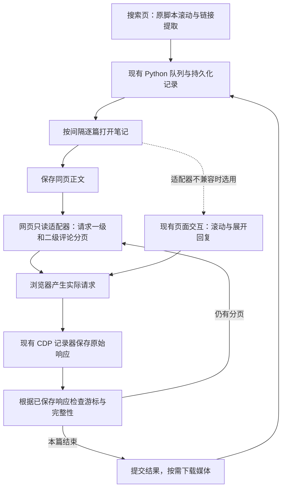

# 小红书批量采集方案

方案修订基线：2026-10-25，第二版。依据新增 Fork 调查、实际源码及用户最新澄清重做选型。方案修订时仅更新文档；后续已开始实现，最新状态见下方接续记录与[采集使用说明](采集使用说明.md)。

用户目标：搜索“Keep4o”等关键词，自动滚动并收集本次搜索结果链接，批量获取正文、一级评论及二级回复，保留原始数据和关系，支持暂停与恢复。允许登录。优先选择能完整取数的实现，页面是否逐条展开不是硬约束。去标识化、文本处理与研究分析另做。

## 接续实现记录（2026-10-25，0.2.0）

- 已接入网页只读请求适配器、两级串行分页、桌面“采集工作台”和 `main.py COLLECT` 入口。
- 原始响应先保存，分页进度提交后再确认操作；补上实际请求关联、真实回复对象索引、游标循环/排序变化/回复数量矛盾检查。去掉强制禁用浏览器缓存。
- 能力检查不兼容时以新尝试使用既有 UI 路径；访问限制和保存失败不触发切换。
- 21 项本地回归测试通过，包含真实 Chrome/CDP 配合合成响应的集成测试；不属于真实平台采集验收。
- 真实网页已确认：专用 Chrome 9223 的 CDP 可用，能发现网页请求包装器；最后检测 `logged_in=false`，尚未验证真实两级后续页。
- 恢复目前为任务级：未完成笔记新建尝试重新遍历，不跨尝试拼接完整性，不直接沿用跨进程旧游标。

下一步：专用 Chrome 手动登录后，按使用说明先进行多页一级/二级评论的小样本验证，再做 10–15 篇覆盖和批量验收。下文仍是完整目标方案，不把尚待验收的目标当作已验证功能。

## 1. 选定方案

**保留 XHS-Downloader 和工作区已有采集框架；优先接入网页内的只读评论请求适配器，用现有 CDP 记录实际响应，再由 Python 按响应中的分页信息推进。**

主要复用来源是 Yht20927/xiaohongshu-cli 的网页请求适配和两级请求组织；浏览器交互备选参考 xpzouying/xiaohongshu-mcp 的评论加载规则。MediaCrawler 与 ReaJason/xhs 用于核对分页流程及边界。

这次不把“先自行开发 Python 签名与评论 HTTP 请求”列为首版主线，也不把所有外部项目整体搬进来。先把一条评论路径验证到可交付：网页请求适配通过就使用；若当前网页不兼容，再完善现有 UI 交互路径。两条路径共用原始存档与完成判定。

选择理由：

- 登录会话留在已有专用 Chrome 中，保留用户已确认的操作体验。
- 网页请求适配可以省去大量滚动、按钮识别、虚拟列表和展开状态的开发。
- CDP 保存真正收到的响应，避免 CLI 格式化结果、数据库字段裁剪或客户端包装造成信息丢失。
- 工作区已经有 Python 队列、存档、游标记录和媒体接入，可继续使用。
- 无需为少数函数再部署完整 Node CLI、Go MCP 服务或新的 WebUI。

**这是基于源码与现有工作区得出的工程推荐，尚未通过当前小红书页面的实测。** 第一阶段必须验证网页内部请求模块仍可用；没有通过前，不把这条路径描述成已运行的成品。

完整证据见[开源复用核查记录](小红书开源复用核查记录.md)。

## 2. 用户最终如何使用

1. 启动本地程序和专用 Chrome，按需手动登录。
2. 在小红书搜索“Keep4o”，选好排序、筛选条件。
3. 启动当前页采集：按原脚本节奏自动滚动，增量提取笔记链接，结束时补提一次。
4. 程序按 note_id 去重，保存关键词、排序、发现时间与完整链接，登记任务队列。
5. 按设定的网页打开间隔逐篇打开笔记；页面就绪后保存正文，并在网页内发起后续评论分页请求。
6. 一级评论持续翻页；每个一级评论下的回复也持续翻页。CDP 同步保存原始响应，Python 检查归属和终止证据。
7. 当前笔记数据写入完成、结果明确后，按需复用原下载器处理媒体，再进入下一篇。
8. 批次结束后显示完整、部分完成、不可访问和待重试数量，可打开存档目录或继续补采。

取数时页面不一定展示所有回复，但程序必须取得并保存对应分页。若使用 UI 备选路径，则打开当前笔记后自动展开回复，网络记录与验收要求完全相同。

“本次搜索结果”指本次滚动实际发现的笔记，不是平台中该关键词的全部结果。50 次仍是原脚本的滚动动作上限，不等于页数或笔记数。作者链接先完成作者页发现，再转为作品任务，不无限扩展。

同一笔记在多个关键词下出现时只采一次，但保留所有发现来源。重新观察已采过的笔记应建立新批次或新尝试，不能被媒体下载历史永久跳过。

## 3. 最小架构与现有代码去留



新增适配器只提供“能力检查、取一级下一页、取指定父评论下一页”三个业务动作。Python 使用已有 Playwright/CDP 连接调用固定函数并传入结构化参数；无需运行外部项目的任意 eval 服务、轮询服务器或完整 CLI。

只读适配器发起的是新的平台请求，不是被动监听。CDP 负责记录实际响应；两者职责分开。默认每次只发起一个受控评论分页操作，等待对应响应验证并落盘后推进。

| 当前工作区 | 已读到的基础 | 本轮方案建议 |
|---|---|---|
| [runner.py](source/collection/runner.py) | 串行笔记任务、导航间隔、页面就绪、暂停、媒体衔接 | 保留；把评论推进拆为可替换策略，加入分页调用与保存确认 |
| [capture.py](source/collection/capture.py) | 导航前监听、两类评论响应、原始正文保存、捕获缺口 | 保留；增加受控操作与实际请求关联，复核缓存与失败处理 |
| [protocol.py](source/collection/protocol.py) | 一级和各回复串游标链、业务失败与归属检查 | 保留；补不同来源字段差异、回复关系索引和恢复边界 |
| [store.py](source/collection/store.py) | 压缩原始文件、哈希、SQLite 事件、任务与尝试记录 | 保留；验证提交顺序、损坏恢复和来源登记 |
| [collection-page.js](static/collection-page.js) | 链接发现、滚动、正文读取、展开控件定位 | 保留发现部分；增加小型请求适配器，原 UI 路径作兼容备选 |
| [app.py](source/application/app.py:626) | 接收浏览器已取得笔记对象的媒体适配入口 | 保留；不重复请求正文，媒体状态独立 |

这些是静态核查到的实现基础，不是本轮验证通过的功能清单。工作区尚需核对实际启动入口、界面接线、依赖和端到端运行情况，不能仅因存在这些文件就判定集成已完成。

当前 capture.py 会禁用缓存；实施时应核实其必要性。默认不为抓包强制清空或关闭缓存；若从缓存取不到响应，应记录来源与缺口，按明确的重新访问任务补采，不能悄悄增加请求并夸大完整性。

## 4. 外部代码复用的取舍

| 来源 | 采用部分 | 需要处理的差异 |
|---|---|---|
| Yht20927/xiaohongshu-cli | 网页请求客户端发现、一级与子评论请求参数、分页组织参考 | 默认一页、二级默认关闭、回复上限 50、缺少充分游标保护、最终结果被整理 |
| xpzouying/xiaohongshu-mcp | 评论容器、展开控件、短评论区先展开等交互规则 | 默认 20 条、回复阈值 10、0 会恢复默认、固定结构丢字段、终止条件不等于完整 |
| MediaCrawler | 两级游标流程和批量处理场景对照 | 自定义许可；常规存储改写用户标识，不直接整库合并 |
| ReaJason/xhs | Python 分页接口与回复关系对照 | 当前适配未实测；不能照搬“短页即结束”等判断 |
| 下载器各 Fork | 个别批次操作和交互设计 | 当前已有队列、存档；另换 WebUI 或同步框架收益有限 |

最值得直接评估的是[Yht 的网页适配](https://github.com/Yht20927/xiaohongshu-cli/blob/5c0159768147b4151d4912c083863a23bbbebb7a/scripts/xiaohongshu.user.js#L161-L212)和[两级请求](https://github.com/Yht20927/xiaohongshu-cli/blob/5c0159768147b4151d4912c083863a23bbbebb7a/scripts/xiaohongshu.user.js#L390-L398)。网页当前版本仍需存在相应 webpack 缓存和请求客户端；这不是稳定官方 API。

其 rawCall 可能重新包装已解包的结果，所以 **Bridge 返回值只作操作反馈，CDP 保存的实际响应才是原始证据及分页依据**。不通过伪造 success 字段或猜测返回形态确认成功。[包装逻辑](https://github.com/Yht20927/xiaohongshu-cli/blob/5c0159768147b4151d4912c083863a23bbbebb7a/scripts/xiaohongshu.user.js#L262-L300)

源码引用按各项目 LICENSE 保留作者、许可和必要修改说明。Yht 使用 MIT，xiaohongshu-mcp 使用 Apache-2.0；MediaCrawler 使用带额外限制的自定义许可，因此不作为首版直接合并来源。更详细的核查及声明区别见配套记录。

## 5. 一篇笔记如何保证尽可能完整

### 5.1 先固定范围和来源

记录 note_id、完整访问链接、当前会话标识、评论排序及分页相关参数、开始时间、适配器版本。查询参数以当前网页真实请求与实测返回为准，不能假定旧项目中的 count / num、置顶或排序参数一直有效。

当前页已自动加载的首批响应可以直接复用；缺失时再明确请求首批。正文使用打开当前页时取得的 HTML、详情响应或初始状态，核验实际 note_id 后保存，避免另发一次 Python 详情请求。

网络正文、HTML、初始状态脚本、页面快照、解析出的笔记对象分别标注类型。初始状态脚本不一定是合法 JSON，解析后的对象也不冒充原始响应。

### 5.2 一级评论和二级回复分别遍历

一级评论从起始游标开始，每收到一页，先保存整个原始响应，再读取本页的评论 ID、下一游标和结束标志。

对每个一级评论：

- 保存响应中已嵌入的全部回复。
- 记录该楼层的根评论 ID、已返回回复 ID、子游标和子分页标志。
- 仍有回复时，继续请求该根评论的后续页，逐页保存，直到该串明确结束。
- 若嵌入回复游标不能用于独立回复接口，实测确认后从该接口首游标重遍历；按 ID 识别重复，同时保留每次原始响应。
- 字段缺失或矛盾时进入待补采，不能把缺失的 has_more 当作 false。

一级结束不代替二级结束；第一页嵌入几条回复不代表这一串完整。每个父评论都必须有单独的结束记录。即使回复对象本身也是二级评论，也要原样保留 target_comment；它与用于请求分页的根评论不是一回事。

### 5.3 数据保真

至少原样保留：

| 数据 | 用途 |
|---|---|
| note_id、comment.id | 识别笔记和评论 |
| user_info.user_id 及其原始用户对象 | 关联同一用户的发言；采集阶段不替换为哈希 |
| root_comment_id 或请求中明确的根评论关联 | 确认回复属于哪个楼层 |
| target_comment 整个对象及其中的 id | 确认具体回复对象，可能指向另一条二级评论 |
| cursor、has_more、sub_comment_cursor、sub_comment_has_more | 分页与完成证据 |
| 原始正文、时间、互动、图片及其他未知字段 | 供后续独立分析或重新解析 |

原始文件保留所有字段；索引只提取调度需要的少量值。真实 ID 缺失就记录未知，不能生成 auto_1 等假 ID 冒充平台标识。按真实评论 ID 统计唯一数量，不能按正文去重；不同用户说同一句话必须保留为不同评论。

如果 target_comment 指向未取得、已删除或不可见的评论，保留这个引用并标明目标未解析，不把它强行改挂到一级评论。采集原始数据和论文中的去标识化是两个阶段。

### 5.4 结束与异常必须区分

只有以下条件同时满足才标 complete_observed：

1. 一级分页链从起点连续到明确终点。
2. 每个已发现的回复串都有连续的结束证据。
3. 相关请求归属、响应业务状态、结构均通过校验。
4. 每个作为证据的响应都已保存并提交索引，且没有捕获缺口。
5. 未因条数、时间、操作上限或错误提前结束；存在相互矛盾的证据时不能报告完整。

这表示本次会话、排序和观察时段下的可见分页完成，不承诺平台历史上全部评论。仍有内容但加载受限、接口变化或达到运行预算时，保留已有数据并标 partial / blocked。

不能把空页、短页、滚动到底、按钮消失、没有新请求、达到显示总数或第三方函数正常返回，单独当作完整证据。返回条数少于请求条数但仍声明有下一页时应继续；重复游标或游标不前进则停止并留缺口，不能无限循环。

**首版不设默认前 20 条或每串前 50 条的数据截断。** 每次运行仍可设故障时间预算与防卡死阈值；触发后是部分完成并可续采，不把它包装成“已全部采集”。设置某个数值为 0 不自动表示无限制，配置语义由本项目明确规定。

## 6. 保存、节奏和恢复

沿用“原始文件 + 状态 SQLite + 可导出清单”：

```text
采集批次/
  run.json           版本、关键词、排序、配置、会话标识
  state.sqlite       任务、来源、尝试、事件、分页与阶段状态
  raw/               原始响应和明确标注的快照
  manifest.jsonl     原始文件及来源索引
  report.json        每篇状态、缺口与停止原因
  diagnostics/       兼容问题、捕获失败与恢复检查
```

每次受控分页在发出前登记任务、尝试、操作 ID 和预期的笔记 / 根评论 / 游标。通过 CDP 实际请求 ID 与业务参数核验结果。不能在响应返回时直接套用“当前笔记”；迟到响应按原请求归档。

先把响应文件持久化并原子重命名，再提交 SQLite 文件索引与分页进度，最后确认操作完成。Python 应等待这份确认后再推进分页；Bridge Promise 返回成功不足以替代落盘成功。

同样的内容可共用哈希文件，但不同请求与时间的事件都保留。数据变化时不覆盖旧观察。Cookie、Authorization 不写入普通日志与导出清单；原始数据只保存在本地受限目录。

**节奏保留原约定：**

- 原脚本的搜索滚动节奏保持。
- 相邻任务导航开始之间的最小间隔为 Δ，同时必须等当前任务收尾；主动重开也算导航。
- 评论分页串行等待实际响应、校验和保存，不新增模拟阅读延迟。
- 平台返回访问限制、登录失效或验证时暂停，不靠快速换路径继续请求。
- 原媒体下载器的请求策略独立保留，不把导航 Δ 套到所有动作上。

完成结果分开记录：正文、一级评论、各回复串、媒体、执行状态。下载历史只影响媒体，不影响评论补采。媒体关闭或失败不能抹掉已经保存的正文、评论结果。

正常暂停停止新操作，收尾在途响应并提交进度。重启校验文件和索引，恢复未完成任务；HTTP 游标有效性依赖当前会话与查询条件。旧游标失效时建立新尝试重遍历，用 ID 与哈希减少重复存储，不把跨时间尝试拼成一次完整快照。

网页适配器不兼容时，记录原因并以新尝试切换 UI 交互。访问限制、验证码、磁盘错误不触发这类切换。

## 7. 实施顺序和验收门槛

### 第一步：验证接入点，先取得真实样本

建议用 10–15 篇笔记覆盖无评论、一级多页、回复超过 50 条、短评论区、含二级互相回复等场景。

验证内容：

- 当前专用 Chrome 中能否发现并调用正确网页请求模块。
- 正常启动及页面重新加载后是否仍可用，不能依赖偶然保留的一次缓存。
- 能否连续取到一级第二页，以及同一父评论的二级后续页。
- 模块返回与 CDP 实际收到的内容能否对应；CDP 是否取得可解释的原始业务响应。
- 参数、排序、笔记与父评论归属正确，业务失败不会变成虚假的 success。
- 真实 user_id、comment_id、target_comment 及分页字段能完整留存。
- 先保存再提交进度的链路有效。

**通过后实现网页分页主线；若模块不可用或不能稳定取得可解释响应，立即转入现有页面交互路径的定向完善。** 这一步验证的是现成适配在当前环境的可用性，不再从零研究评论分页机制。

UI 备选优先参考 xiaohongshu-mcp 已处理的短评论区先展开、更多回复文案和真实滚动容器；所有结束状态仍由本地原始响应判定，不照搬它的默认条数和跳过阈值。

### 第二步：接通单篇完整保存

在已有 runner / capture / protocol / store 上加入只读请求适配，完成一级及二级游标循环、请求关联、持久化确认和独立结果。默认不开媒体；媒体开启时复用已有笔记对象入口。

这一阶段的“成功”必须包含真实回复分页和原始关系字段，不能只拿到一份看似丰富的整理后 JSON。

### 第三步：入口联调与恢复

接通当前搜索页发现、批量入队、开始、暂停、继续、失败补采与打开目录。不新建另一套 WebUI、队列或同步服务器。补齐实际启动方式与最小依赖，固定外部代码来源提交和适配器版本。

保留目前仍可用的采集模块；在需要替换的函数范围内改造，不因为找到其他项目就整体重写。

### 第四步：覆盖和耐久性验收

建议使用至少 100 条任务作为工程验收批次，其中安排重复链接、已有媒体记录、正常失败和高评论量样本。100 条是工作流验收规模，不是研究样本上限或长期稳定性证明。

| 验收场景 | 必须满足 |
|---|---|
| 一级评论超过 20 条、单串回复超过 50 条 | 不受外部项目默认截断，后续页均可追踪 |
| 回复 B 指向另一条二级评论 A | 保存 B 的真实 target_comment.id，不仅保存根评论 ID |
| 两位用户发表相同文字 | 两条记录及各自真实 ID 均保留 |
| 空页或短页仍有后续、重复游标 | 前者按有效游标继续，异常不伪装成结束；后者不死循环 |
| 当前页面直接显示末尾，但仍有可展开回复 | 不提前完成；UI 备选也必须通过 |
| 请求成功但文件写入失败 | 不提交成功页进度，暂停批次 |
| Bridge 返回被包装为 success，但实际响应失败 | 以实际响应为准，正确报告失败或阻断 |
| 中途关闭程序、重启 | 已确认文件可读，未完成任务可恢复，历史尝试保留 |
| 迟到响应、重复请求 | 不串篇，不因去重丢失不同观察 |
| 以前下载过媒体、这次关闭媒体 | 正文和评论仍按范围处理，状态独立 |
| 页面模块或字段结构变化 | 保留诊断，停止或使用明确的兼容路径，不静默保存空结果 |

覆盖对照使用相近时间、同一登录会话和排序下的人工正常加载结果，比较评论 ID、真实回复对象和分页证据。数量相等不等于记录相同；发现动态新增、删除或排序变化应单独解释。

## 8. 工作量重新估算

| 工作部分 | 相比原方案 | 当前剩余工作 |
|---|---|---|
| 多链接处理、媒体下载 | 原项目已有 | 接口兼容验证 |
| 搜索滚动和链接发现 | 原脚本及当前适配器已有 | 接线、来源登记及漏链验证 |
| 原始存档、队列、导航间隔、尝试记录 | 工作区已有框架 | 边界复核与端到端验证 |
| 评论协议探索 | 有明确的两级请求和分页源码 | 验证当前网页参数、会话与返回 |
| 大量 DOM 展开自动化 | 主路线可省去 | 只在网页请求适配不兼容时完善 |
| 逐页完整性、真实回复关系、错误恢复 | 外部项目不能直接满足 | 核心定向改造 |
| 新 Node/Go 服务、新 WebUI、数据分析 | 首版不需要 | 不计入开发范围 |

因此，工作量确实下降了，主要减少协议探索和 UI 自动化的试错。当前任务更适合拆成：**一个短可行性验证、一个网页只读适配器、现有分页与存档边界修正、一轮批量验收。**

剩余工作不能只按新增代码行数衡量。当前网页私有模块是否可用、分页有没有截断、响应能否无损保存，需要真实验证后才能给出可靠工期与吞吐估计。首轮记录单篇耗时分布、分页数、存储量及部分完成原因，再决定正式批次规模。

最终交付目标为：沿用当前基础的可运行 Fork、已验证的评论取数路径、完整原始数据及清单、暂停与恢复操作、真实试采报告和来源声明。方案修订时的交付是文档与核查记录；后续实现进度见本文开头接续记录，真实试采报告尚待登录后验证。
